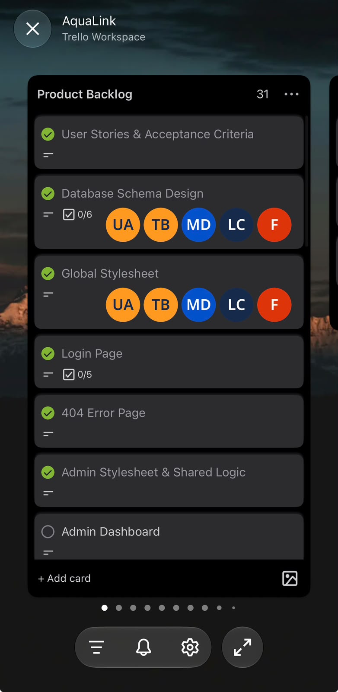

---
layout: default
title: Agile Team Charter
permalink: /agile-team-charter.html
---

Agile Portfolio · Team Collaboration

# Agile Team Charter

### Establishing shared purpose, responsibility and accountability.

AquaLink was developed to explore how technology could support the management of water distribution in underserved communities.

As Project Lead, I was responsible for helping coordinate the development process while contributing substantially to the frontend.

This required me to consider two connected responsibilities: how the team organised its work, and how I could contribute to delivering a functional, understandable application.

Our collaboration was organised through project planning, Trello tasks, agreed requirements and development reviews.

Although we did not produce a formally signed team charter, these working arrangements provide evidence of how we coordinated the project.

---

## 01. Our Shared Purpose

Our common objective was to develop AquaLink: Smart Community Water Distribution and Management.

The application was designed around Admin and Supplier roles, with functionality supporting households, water infrastructure, subscriptions, purchases and monitoring information.

Our shared goal was to translate this concept into an application that could be demonstrated and evaluated.

Project Purpose

### Connecting Water. Empowering Communities.

The purpose behind AquaLink was to apply our technical knowledge to a problem with social significance.

For me, this purpose made the project more than an academic requirement. It was an opportunity to explore how the education I was receiving could contribute to communities facing real challenges.

---

## 02. My Role in the Team

01

### Project Lead

I helped coordinate development activities, monitor project progress, review priorities and follow up on work required for delivery.

02

### Frontend Contributor

I contributed substantially to interface development, page layouts, visual consistency, navigation and the overall user experience.

Balancing these responsibilities required me to understand both the technical work and the coordination necessary to keep the project moving.

My role was not simply to assign tasks. It also involved understanding dependencies between features and recognising when unfinished work could affect later development or presentation activities.

---

## 03. Evidence of Team Coordination

The AquaLink Agile Logbook provides dated evidence of the activities I recorded as Project Lead.

The following entries are particularly relevant to team coordination and shared working expectations.

| Date | Recorded Activity | Relevance to Team Coordination |
|---|---|---|
| 27 July 2026 | Reviewed project scope and agreed user stories | Establishing a shared understanding of requirements |
| 31 July 2026 | Consolidated user-story scope and development priorities | Organising the work ahead |
| 7 August 2026 | Consolidated UI feedback and mapped remaining screens to the backlog | Coordinating design and development activities |
| 4 September 2026 | Checked shared components and navigation and noted inconsistencies | Reviewing work across application areas |
| 22 October 2026 | Reviewed the remaining backlog and separated completed work from outstanding integrations | Making progress and remaining responsibilities visible |
| 29 October 2026 | Reviewed the 11-sprint roadmap and reprioritised remaining work | Responding to the approaching presentation milestone |

**Source:** AquaLink Agile Logbook, dated entries from 27 July to 29 October 2026.

[View the Original Agile Logbook](evidence/documents/AquaLink_Agile_Logbook.docx)

These records show how I approached planning, coordination and review throughout the project.

---

## 04. Our Working Arrangements

The team used Trello and the project backlog to organise development work.

The logbook records the following coordination practices:

| Working Area | Documented Practice |
|---|---|
| Requirements | Reviewing agreed user stories and acceptance criteria |
| Task Planning | Mapping development activities to backlog priorities |
| Development Coordination | Reviewing dependencies between screens and application components |
| Quality | Checking navigation, consistency, responsiveness and defects |
| Progress Tracking | Recording completed work, planned activities and impediments |
| Final Delivery | Reviewing remaining work and preparing for the presentation milestone |

These practices formed the basis of our collaboration.

However, one limitation became clear: working arrangements are more effective when expectations about responsibility, communication and missed deadlines are explicitly documented and agreed upon.

---

## 05. Original Supporting Evidence

### Trello Task Organisation

*Original AquaLink Trello evidence. The board records project tasks and their organisation.*

### Agile Logbook — Project Coordination

The logbook provides a second evidence source by documenting planning decisions and development reviews.

Particularly relevant entries include:

**31 July 2026**

Consolidated the initial user-story scope and prepared subsequent development priorities.

**7 August 2026**

Consolidated UI feedback and mapped remaining screens to the backlog.

**22 October 2026**

Reviewed the remaining backlog and distinguished completed application work from outstanding integration and delivery activities.

**29 October 2026**

Reviewed the 11-sprint roadmap and reprioritised remaining work around documentation, rehearsal and presentation preparation.

[Download the Complete Logbook](evidence/documents/AquaLink_Agile_Logbook.docx)

[Explore All Trello Evidence](evidence-gallery.html)

---

## 06. Evaluating Our Team Agreements

Our planning records demonstrate that development activities were organised and reviewed.

However, the experience also exposed limitations in how working expectations were established.

The most important weakness was not the absence of tasks. It was the lack of sufficiently explicit agreements about what should happen when work was delayed or responsibilities were not fulfilled.

As Project Lead, I sometimes found it difficult to balance coordinating progress with completing my own frontend responsibilities.

This taught me that a project can have a backlog, development schedule and shared objective while still needing stronger team agreements.

My Main Learning

### Task visibility is not the same as accountability.

Trello made project work visible.

However, effective collaboration also required clear ownership, realistic expectations, communication and a shared understanding of how the team should respond to difficulties.

---

## 07. My Personal Reflection

The Team Charter criterion made me reflect on something I had underestimated at the beginning of AquaLink: the importance of establishing expectations before problems arise.

I entered the project with a strong sense of purpose.

I wanted us to build an application that was technically meaningful and professionally presented.

I also wanted to contribute directly to the frontend, particularly the visual experience and functionality of the application.

But leadership required a different kind of attention.

It required me to think about how responsibilities were understood, how progress was communicated and what happened when development did not proceed as expected.

Looking back, I believe we would have benefited from establishing a clearer agreement at the beginning of the project.

A formal charter would not necessarily have prevented every difficulty. However, it could have provided a shared reference point for responsibilities, communication and accountability.

The experience changed how I understand leadership.

I no longer see team coordination as simply ensuring that tasks exist on a board.

I see it as establishing the expectations and working conditions that help people contribute effectively.

---

## 08. What I Would Establish in Future Projects

Based on this experience, I would introduce the following team agreements during project initiation.

| Agreement | Intended Benefit |
|---|---|
| Defined responsibilities | Reduce uncertainty about task ownership |
| Agreed deadlines | Establish realistic delivery expectations |
| Regular progress updates | Identify problems earlier |
| Blocker reporting | Encourage early communication about difficulties |
| Task acceptance criteria | Establish a shared definition of completion |
| Escalation arrangements | Provide a constructive response to missed commitments |
| Sprint retrospectives | Support continuous improvement |

This table is my retrospective proposal for improving future teamwork, not a historical signed charter.

---

## 09. Connection to Agile Practice

The Scrum Guide emphasises transparency, inspection and adaptation as foundations of Scrum (Schwaber and Sutherland, 2020).

These principles are relevant to my experience because project coordination required more than tracking completed tasks.

It required making progress visible, identifying difficulties and adjusting priorities when necessary.

The experience helped me appreciate why effective Agile collaboration depends on both technical organisation and shared responsibility.

### Reference

Schwaber, K. and Sutherland, J. (2020) *The Scrum Guide: The Definitive Guide to Scrum: The Rules of the Game*. Available at: https://scrumguides.org/scrum-guide.html (Accessed: 7 November 2026).

---

## 10. Final Reflection

AquaLink taught me that leadership begins with clarity.

A team needs a shared purpose, but it also needs a shared understanding of how people will work together.

The project helped me recognise the importance of establishing expectations early, communicating responsibilities clearly and responding constructively when progress becomes difficult.

As a future IT professional, I want to carry these lessons into every team I join or lead.

**A shared vision gives a team direction. Clear agreements help turn that vision into coordinated action.**

---

[← Our Story](our-story.html)

[Next: User Stories and Tasks →](user-stories-and-tasks.html)

