

Agile Portfolio · Original Project Evidence

# Evidence Gallery

### The work behind AquaLink, documented.

AquaLink was developed through planning, collaboration, technical implementation and continuous problem-solving.

This gallery brings together the original Trello screenshots and Agile Logbook that support the development journey described throughout my portfolio.

These are project records, not recreated examples.

---

## 01. Evidence Collection

16

### Trello Screenshots

Original screenshots showing backlog items, sprint planning, task assignments and development tracking.

01

### Agile Logbook

The original Word document recording development activities from 27 July to 29 October 2026.

08

### Sprint Sections

The Trello evidence includes sprint-labelled planning sections through Sprint 8.

---

## 02. Original Trello Evidence

The following screenshots are presented in their supplied file order.

The numbering identifies each screenshot in this portfolio; it does not imply the chronological order in which Trello cards were created or updated.

### Screenshot 01

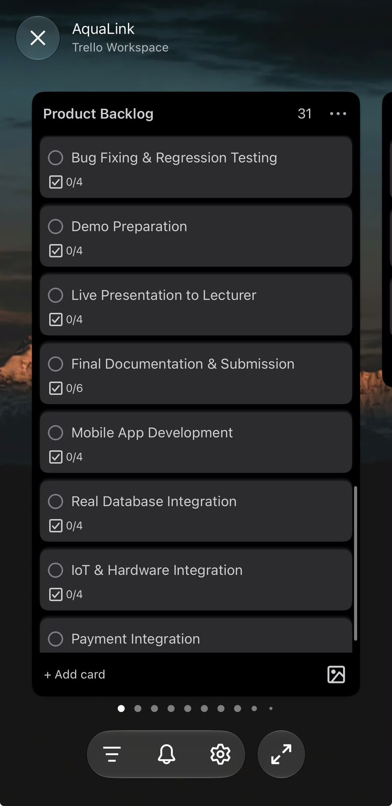

### Screenshot 02

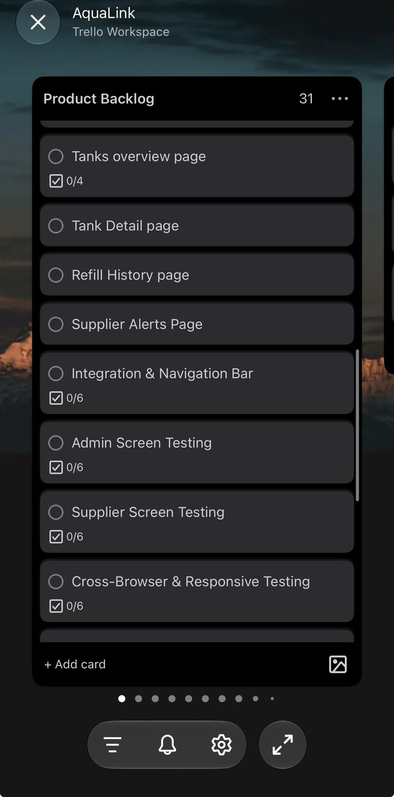

### Screenshot 03

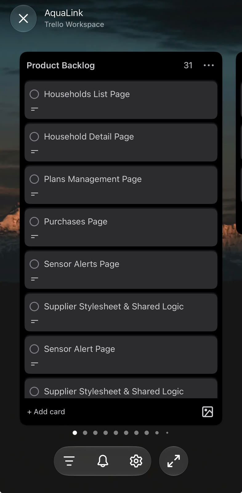

### Screenshot 04

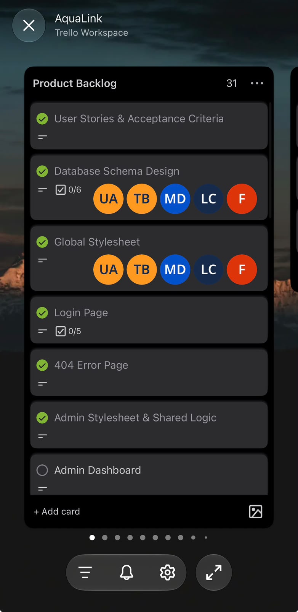

### Screenshot 05

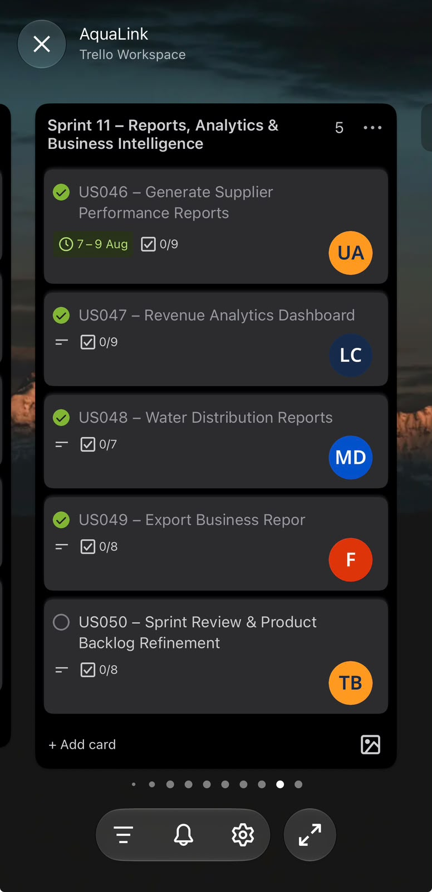

### Screenshot 06

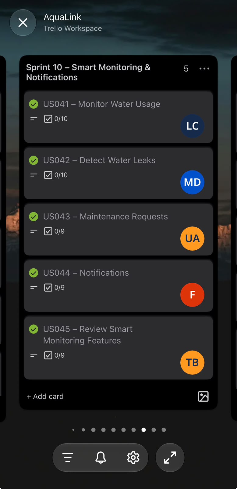

### Screenshot 07

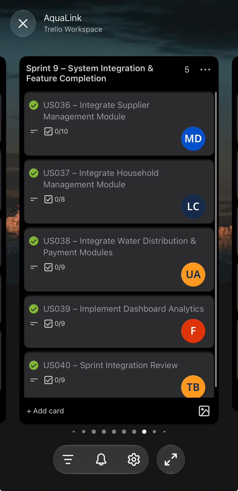

### Screenshot 08

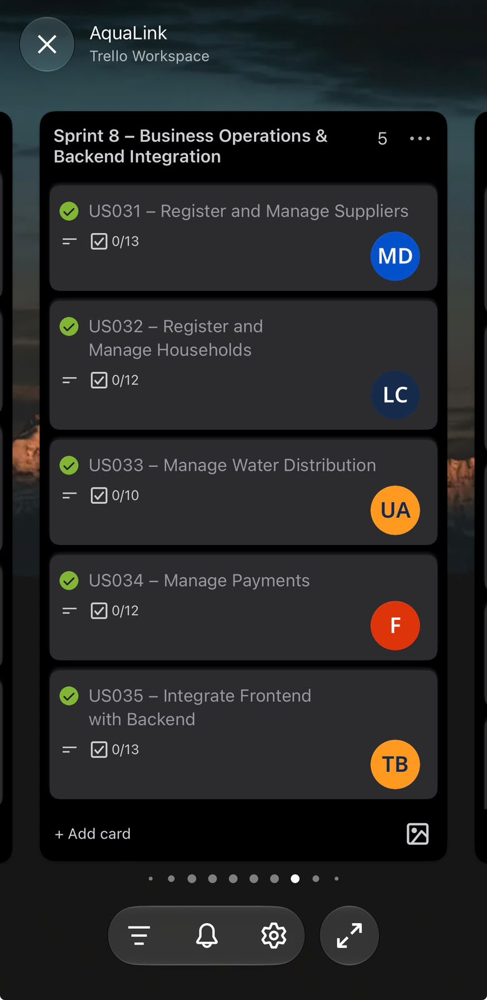

### Screenshot 09

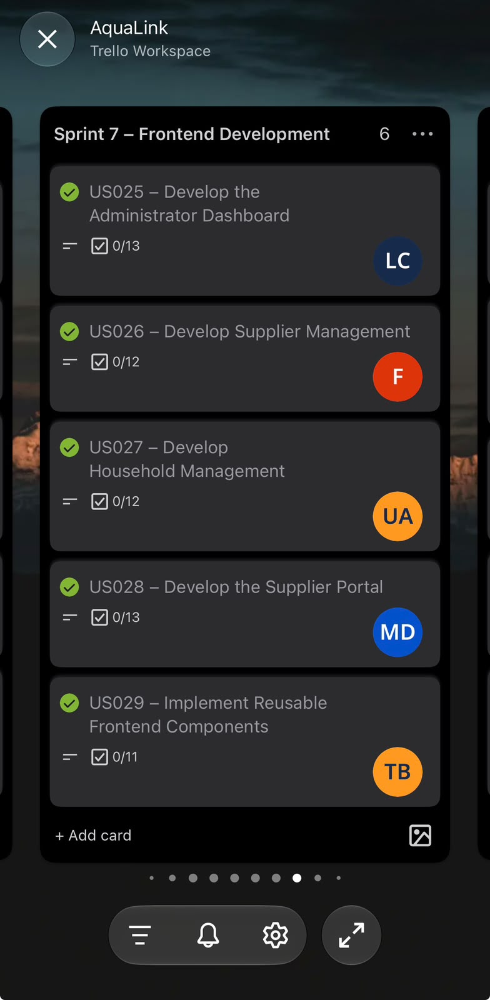

### Screenshot 10

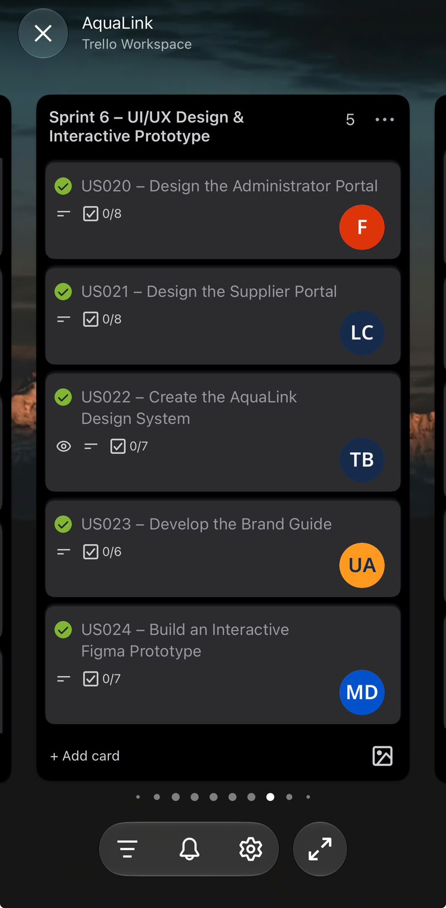

### Screenshot 11

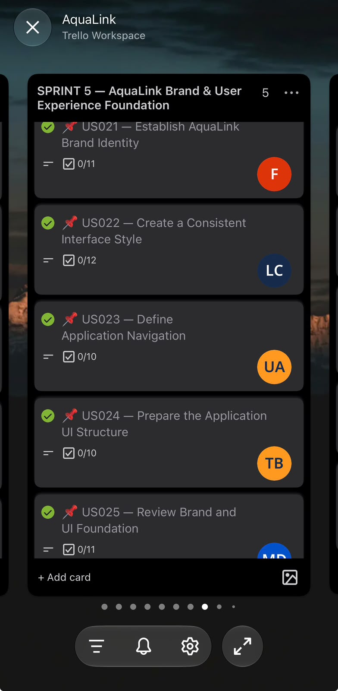

### Screenshot 12

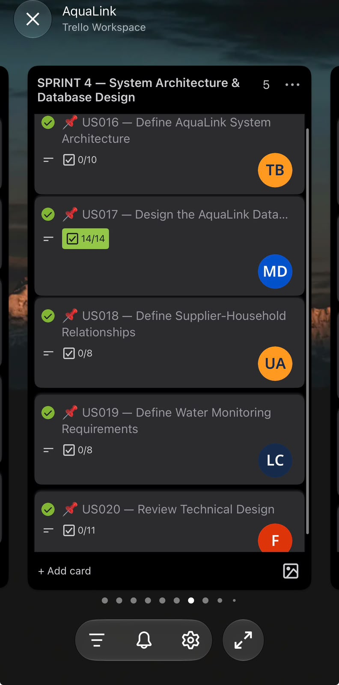

### Screenshot 13

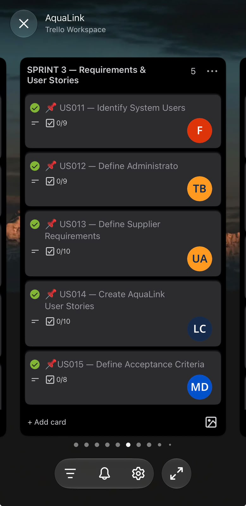

### Screenshot 14

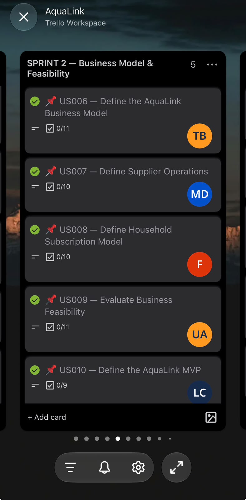

### Screenshot 15

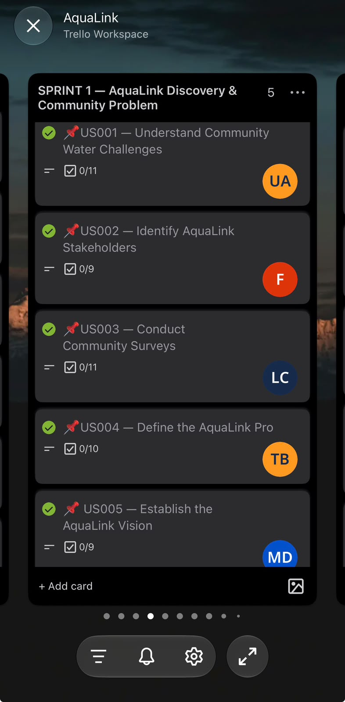

### Screenshot 16

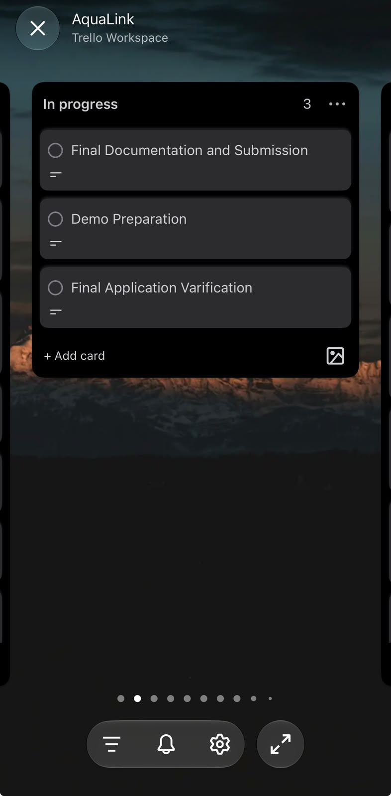

---

## 03. Original Agile Logbook

Primary Evidence · Word Document

### AquaLink Agile Logbook

**Period:** 27 July – 29 October 2026

The logbook documents development activities, planned work, impediments and progress during the project.

[Download Original Agile Logbook](evidence/documents/AquaLink_Agile_Logbook.docx)

[Read My Agile Logbook Reflection](agile-logbook.html)

---

## 04. Additional Project Sources

- [Original AquaLink Trello Board](https://trello.com/invite/b/6a61c8f1356d8a59c782231c/ATTIf9d9fdf7ec47fcd3745825ca9a054a2898604B70/aqualink)
- [AquaLink GitHub Repository](https://github.com/TonyBaloyi/AquaLink)
- [Agile Team Charter](agile-team-charter.html)
- [User Stories and Tasks](user-stories-and-tasks.html)
- [Product Backlog](product-backlog.html)
- [Sprint Backlog](sprint-backlog.html)

The original Trello board may require permission to view. Screenshots are included here to preserve the evidence within the portfolio itself.

---

## 05. My Reflection on Evidence and Accountability

Collecting project evidence helped me understand the importance of documenting development as it happens.

As Project Lead, I experienced situations where tasks were delayed, responsibilities were not completed on time and team participation was inconsistent.

These experiences made me appreciate why Agile teams need transparent records of their work.

A backlog shows what we intended to accomplish.

A sprint board shows how work was organised.

A logbook records the activities, challenges and progress that occurred during development.

Together, these sources tell a more complete story than the finished application alone.

I also learned that documentation should be accurate.

An implemented interface should not be presented as a fully integrated feature unless the integration has been verified.

A planned activity should not be described as completed without supporting evidence.

For future projects, I want to maintain stronger links between tasks, commits, testing results and development records.

**The value of evidence is not simply proving that work happened. It is helping us understand how that work happened, what we learned and how we can improve.**

---

[← Agile Logbook](agile-logbook.html)

[Next: Leadership Reflection →](leadership-reflection.html)

