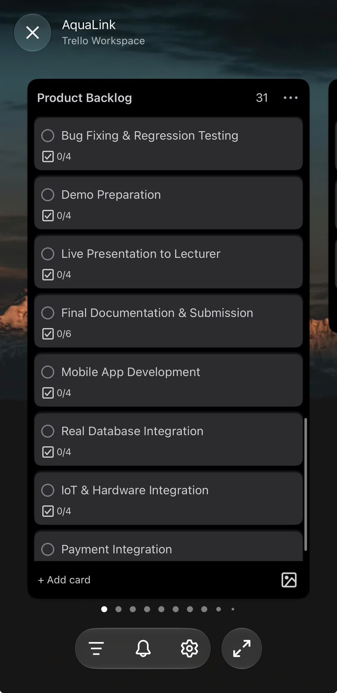
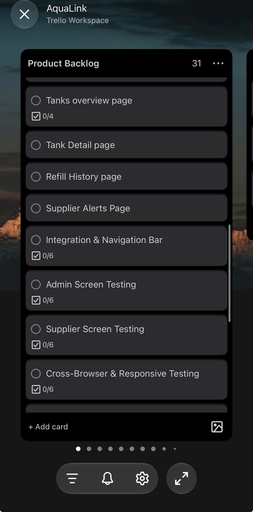
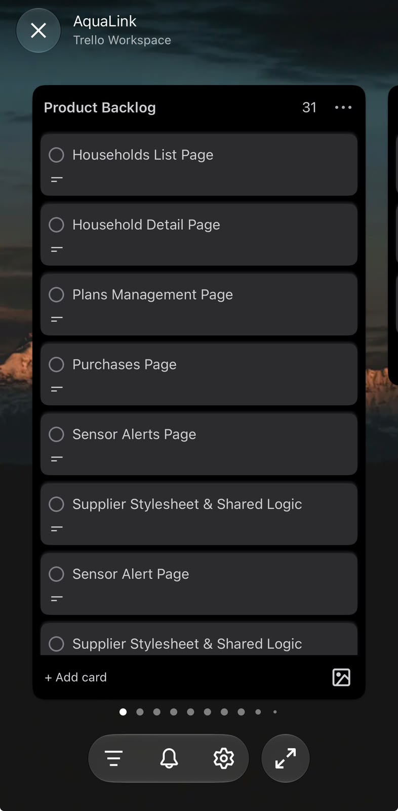

---
layout: default
title: Product Backlog
permalink: /product-backlog.html
---

Agile Portfolio · Planning & Prioritisation

# Product Backlog

### Turning our vision into a structured development plan.

AquaLink began with an ambitious goal: to explore how technology could improve community water distribution and management.

However, a vision alone does not tell a development team what to build first.

We needed to identify features, organise requirements, understand dependencies and make decisions about what could realistically be delivered.

Our Product Backlog became a central place for organising that work.

---

## 01. Why We Needed a Product Backlog

Our proposed solution involved several interconnected areas:

- Administration and platform management.
- Household information.
- Water suppliers and infrastructure.
- Subscription and payment-related features.
- Monitoring, readings and alerts.
- Shared application functionality.
- Database and external service integration.

These areas could not all be completed simultaneously.

The backlog helped us break a large project into manageable pieces and make the work visible.

The Planning Principle

### A feature is not complete simply because it has been designed.

AquaLink required us to distinguish between an interface that had been implemented, a feature connected to persistent data, and functionality dependent on an external service or physical hardware.

Understanding these differences became important when reviewing our progress.

---

## 02. Our Product Backlog

Our Trello evidence shows a Product Backlog containing development items across administration, supplier operations, shared styling and integration.

The Agile Logbook also records completed application screens and outstanding technical dependencies.

| Workstream | Backlog Items | Status in October Logbook |
|---|---|---|
| Administration | Admin dashboard | Recorded as completed |
| Household Management | Household list and detail screens | Recorded as completed |
| Plans and Purchases | Plan management and purchase-related screens | Recorded as completed |
| Supplier Operations | Tank overview and detail screens | Recorded as completed |
| Supplier Operations | Refill history | Recorded as completed |
| Monitoring | Supplier and sensor alert screens | Recorded as completed |
| Shared Frontend | Global, Admin and Supplier styling | Recorded as completed |
| Shared Functionality | Navigation and reusable application logic | Recorded as completed |
| Data Integration | Real database/API integration and CRUD verification | Remaining work in dated logbook |
| Payments | External payment provider integration | Remaining work in dated logbook |
| IoT Monitoring | Physical sensor and hardware readings | Remaining work in dated logbook |
| Project Delivery | Documentation and final presentation | Finalisation activities recorded |

**Important:** These statuses reflect the dated Agile Logbook, not a fresh verification of the currently deployed application. Some integration work progressed after the logbook period.

---

## 03. How We Approached Prioritisation

Our project records demonstrate that work was organised into backlog and sprint activities.

For this portfolio, the work can be understood through three planning considerations.

01

### User-Facing Functionality

The screens and interactions needed to demonstrate the platform's main roles and capabilities.

02

### Shared Foundations

Navigation, consistent styling and reusable functionality that supported multiple application screens.

03

### Technical Dependencies

Database integration, payment services and physical sensor connections that required additional implementation or verification.

This grouping explains the dependencies visible in our work. It should not be interpreted as a formally documented numerical priority ranking.

---

## 04. My Contribution to Backlog Delivery

As Project Lead and a major frontend contributor, I experienced the relationship between backlog planning and implementation directly.

My frontend work focused on the appearance, usability and interactive features of AquaLink.

I wanted the application to feel coherent rather than like a collection of unrelated pages.

That meant paying attention to consistent styling, navigation, page structure and the way information was presented to users.

However, the backlog also reminded me that visual progress was not the same as completing the entire system.

A dashboard could look finished while its data integration was still being developed.

A payment page could exist without a verified external payment provider.

Recognising these differences helped me think more carefully about what it means to describe a feature as complete.

---

## 05. Original Product Backlog Evidence

The screenshots below are from our original AquaLink Trello records.

They are included so that the lecturer can inspect our planning evidence even if the Trello invitation link is inaccessible.

### Trello Product Backlog — Screenshot 1

### Trello Product Backlog — Screenshot 2

### Trello Product Backlog — Screenshot 3

These images will appear once the original screenshots are uploaded to the evidence folder using the filenames shown above.

### Additional Evidence

- [Open the Original Trello Board](https://trello.com/invite/b/6a61c8f1356d8a59c782231c/ATTIf9d9fdf7ec47fcd3745825ca9a054a2898604B70/aqualink)
- [View the Sprint Backlog](sprint-backlog.html)
- [View the Agile Logbook](agile-logbook.html)
- [Explore the Evidence Gallery](evidence-gallery.html)

---

## 06. The Challenge of Keeping Work on Track

One of the difficulties I experienced as Project Lead was managing progress when team engagement was inconsistent.

There were times when deadlines were missed and I felt that some team members were not participating as actively as the project required.

This was frustrating because I was also contributing heavily to frontend development.

The backlog could show what needed to be done, but it could not guarantee that the work would be completed.

I began to understand that a development plan only becomes useful when the team consistently acts on it.

> A backlog makes responsibilities visible. Accountability is what turns those responsibilities into progress.

---

## 07. My Personal Reflection

The Product Backlog taught me an important lesson about the difference between ambition and delivery.

At the beginning, I was excited about everything AquaLink could become.

I wanted the frontend to look professional, the features to work properly and the finished solution to communicate the purpose behind the project.

But software development requires decisions about time, dependencies and priorities.

The backlog helped me understand that we could not treat every feature as equally urgent.

It also exposed a leadership challenge: assigning work is not the same as ensuring that work progresses.

When participation was inconsistent, I sometimes became frustrated because delays affected the team and increased the pressure on the work I was already doing.

Looking back, I believe I could have managed this more effectively through earlier follow-ups, clearer deadlines and more explicit ownership of backlog items.

### What I Would Improve

In a future project, I would:

1. Give every backlog item a clear priority.
2. Assign a responsible owner to each task.
3. Link backlog items to user stories and acceptance criteria.
4. Record dependencies between frontend and backend work.
5. Review incomplete items at regular intervals.
6. Distinguish implemented interfaces from fully integrated features.
7. Reprioritise work when deadlines or available resources change.

These are lessons I would apply in future projects, rather than claims that every practice was formally implemented during AquaLink.

---

## 08. What I Learned

AquaLink taught me that a Product Backlog is more than a list of features.

It is a way of making a project's ambitions manageable.

As a frontend developer, it helped me understand where my work fitted into the larger system.

As Project Lead, it taught me the importance of balancing expectations with actual delivery.

**A successful project is not measured only by what we planned to build, but by how responsibly we managed the work required to build it.**

---

[← User Stories and Tasks](user-stories-and-tasks.html)

[Next: Sprint Backlog →](sprint-backlog.html)

