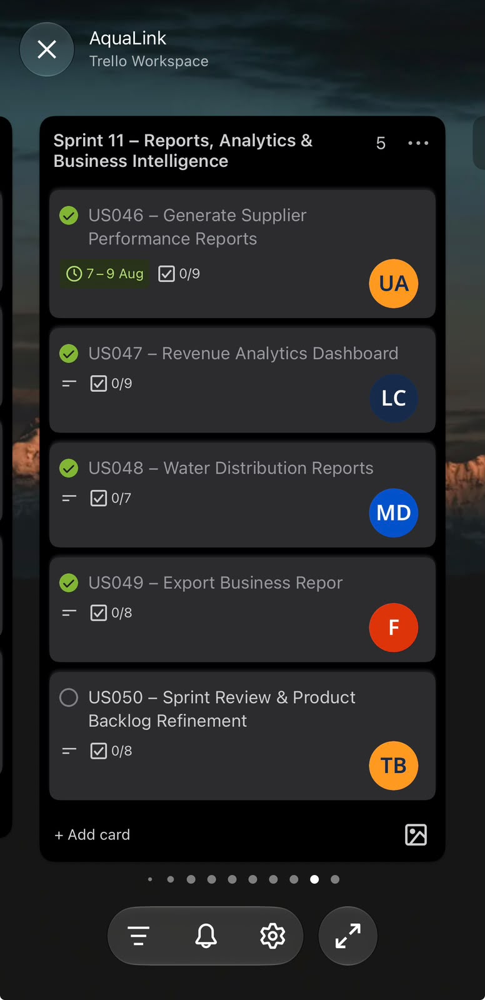
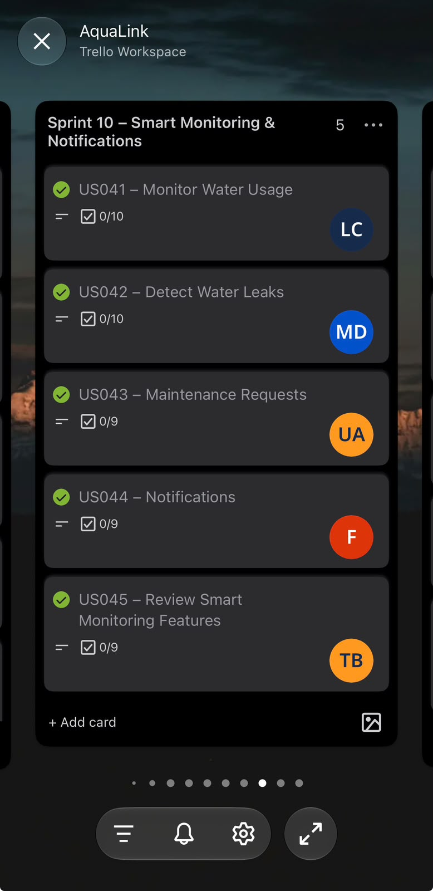
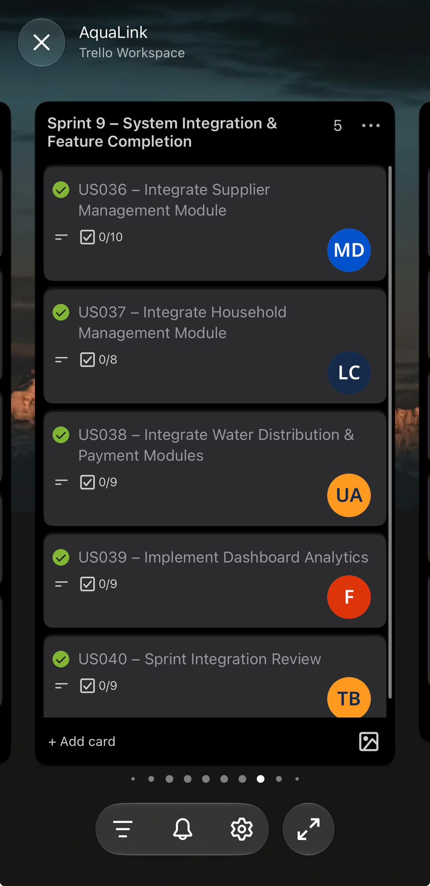

---
layout: default
title: Sprint Backlog
permalink: /sprint-backlog.html
---

Agile Portfolio · Sprint Planning & Delivery

# Sprint Backlog

### Turning planned work into measurable development progress.

AquaLink required the coordination of multiple development activities, from requirements analysis and frontend implementation to testing and presentation preparation.

As Project Lead and a substantial frontend contributor, I experienced how important it was to organise work into manageable stages.

The Sprint Backlog helped us focus on immediate development priorities while maintaining an understanding of the wider product objectives.

The original Agile Logbook documents an 11-sprint roadmap and provides dated records of completed activities, planned work and impediments.

---

## 01. Understanding Our Sprint Planning

The purpose of sprint planning was to identify the work that needed attention during a particular development period.

For AquaLink, this involved:

- Reviewing user stories and requirements.
- Identifying development priorities.
- Organising frontend implementation.
- Reviewing dependencies between features.
- Monitoring progress and impediments.
- Testing completed screens and navigation.
- Preparing for the final presentation.

The project was developed through successive workstreams rather than attempting every feature simultaneously.

My Main Learning

### Planning work is different from completing work.

A sprint plan creates direction, but progress must be evaluated against what was actually achieved.

I learned that effective sprint management requires realistic commitments, visible progress and the willingness to adapt when circumstances change.

---

## 02. Our Development Timeline

The original logbook records development activities between 27 July and 29 October 2026.

The following table groups these documented activities into their major workstreams.

It is a summary of the recorded timeline, not a replacement for the original 11-sprint schedule.

| Period | Recorded Workstream | Main Activities |
|---|---|---|
| 27–31 July | Requirements and user stories | Scope, acceptance criteria, workflows and priorities |
| 3–7 August | UI/UX foundations | Visual consistency, reusable components and screen requirements |
| 10–14 August | Architecture and data | System architecture, database entities and integration dependencies |
| 17–21 August | Admin implementation | Dashboard, households, plans and purchase workflows |
| 24–28 August | Supplier operations | Tanks, refill history and alerts |
| 31 August–4 September | Shared components | Styling, common logic and navigation |
| 7–11 September | Screen integration | Navigation and consistency between application screens |
| 14–18 September | Application review | Checking implemented screens against requirements |
| 21–25 September | Quality checks | Admin and Supplier testing activities |
| 28 September–2 October | Bug fixing and responsiveness | Regression, responsive layouts and browser checks |
| 5–9 October | Integration boundaries | Reviewing completed screens and outstanding integrations |
| 12–16 October | Documentation | Business model, architecture and supporting materials |
| 19–23 October | Demo preparation | Demonstration routes, presentation content and task review |
| 26–29 October | Final review | Reprioritisation, documentation and presentation readiness |

**Source:** AquaLink Agile Logbook, dated entries from 27 July to 29 October 2026.

[Download the Original Agile Logbook](evidence/documents/AquaLink_Agile_Logbook.docx)

---

## 03. Evidence of Planned Work and Impediments

The Agile Logbook followed three recurring questions:

1. What did I complete since the last stand-up?
2. What am I planning to complete before the next stand-up?
3. What are my impediments, risks or problems?

This structure helped connect recorded progress with the next development activities.

### Example A: Requirements Planning

**27 July 2026**

**Completed:** Reviewed the AquaLink scope and agreed user stories.

**Planned:** Refine acceptance criteria and confirm required workflows.

**Impediment:** Some acceptance criteria depended on clarification of operational workflows.

**My learning:** Requirements uncertainty can affect later implementation. Resolving it early reduces unnecessary rework.

### Example B: Frontend Development

**17 August 2026**

**Completed:** Worked through the Admin dashboard story and refined the layout for operational summaries and navigation.

**Planned:** Continue with household list and household details workflows.

**Impediment:** Dashboard information needed to remain readable and consistent with the data model.

**My learning:** Frontend tasks are connected. Decisions about shared information and navigation can influence several screens.

### Example C: Responsive Testing

**30 September 2026**

**Completed:** Reviewed Supplier pages at desktop and smaller widths, focusing on tank, refill and alert information.

**Planned:** Complete responsive checks and adjust layouts where necessary.

**Impediment:** The interface needed to remain usable rather than simply shrink to fit.

**My learning:** A visually complete interface still requires testing under different conditions.

### Example D: Final Reprioritisation

**29 October 2026**

**Completed:** Reviewed the 11-sprint roadmap and reprioritised remaining work around documentation, rehearsal and the presentation.

**Planned:** Confirm final Trello statuses, rehearse and agree on immediate post-presentation priorities.

**Impediment:** The approaching presentation required controlled scope and clear disclosure of unfinished integrations.

**My learning:** Sprint priorities must respond to delivery constraints without hiding outstanding work.

---

## 04. Connecting Sprint Activities to Deliverables

The following table connects documented development activities to the deliverables recorded in the logbook taskboard.

| Development Area | Related Deliverables | Recorded Outcome |
|---|---|---|
| Requirements | User stories and acceptance criteria | Completed |
| UI foundations | Global, Admin and Supplier styling | Completed |
| Admin screens | Dashboard, households, plans and purchase pages | Screen implementation completed |
| Supplier screens | Tanks, refill history and alert pages | Screen implementation completed |
| Navigation | Shared navigation and page routes | Completed |
| Quality | Screen, browser, responsive and regression testing | Recorded as completed |
| Data integration | Persistent backend/database workflows | Remaining in the dated taskboard |
| Payments | Real payment-provider workflow | Remaining in the dated taskboard |
| IoT | Physical sensor integration | Remaining in the dated taskboard |
| Final delivery | Documentation, rehearsal and presentation | Finalisation activities recorded |

The table reflects the status recorded in the logbook, rather than claiming that all planned integrations were operational.

---

## 05. How We Responded to Dependencies

Some development activities could not be evaluated independently.

For example, the tank monitoring interface could be designed and reviewed without physical sensors being connected.

Similarly, a purchase page could be implemented before a real payment-provider workflow was available.

01

### Interface Dependencies

Shared styling, navigation and components affected multiple screens.

02

### Backend Dependencies

Persistent data workflows required functioning backend services and database integration.

03

### External Dependencies

Payment services and physical sensor readings depended on additional integration work.

These dependencies influenced how development progress was assessed.

They also demonstrated why unfinished integration work needed to remain visible even after the related frontend screens were completed.

---

## 06. Original Trello Sprint Evidence

The original Trello board was used to organise and monitor project work.

### Sprint Planning and Task Progress

*Original AquaLink Trello screenshot from the project evidence collection.*

*Original AquaLink Trello screenshot showing project work.*

### Additional Sprint Evidence

*Additional original Trello evidence.*

### Supporting Artefacts

- [Original AquaLink Trello Board](https://trello.com/invite/b/6a61c8f1356d8a59c782231c/ATTIf9d9fdf7ec47fcd3745825ca9a054a2898604B70/aqualink)
- [Original Agile Logbook](evidence/documents/AquaLink_Agile_Logbook.docx)
- [Evidence Gallery](evidence-gallery.html)
- [Product Backlog](product-backlog.html)

---

## 07. My Individual Contribution

My responsibilities connected project coordination with frontend development.

As a frontend contributor, I focused on implementing and improving the user-facing application.

The logbook records work involving:

- Admin dashboard layout and navigation.
- Household list and detail workflows.
- Supplier tank and alert interfaces.
- Shared styles and reusable components.
- Navigation between application screens.
- Responsive and browser-related reviews.

As Project Lead, I also needed to monitor the relationship between planned activities and the project's delivery requirements.

This required me to consider whether the immediate workload was realistic and whether dependencies could prevent progress.

I learned that development progress cannot be measured only by the number of screens completed.

It must also consider functionality, quality and readiness for integration.

---

## 08. My Reflection: Capacity and Adaptation

The Sprint Backlog helped me understand the difference between ambition and realistic planning.

At the beginning of a development project, it is easy to focus on everything the application could eventually achieve.

However, time and development capacity are limited.

As the AquaLink project progressed, I began to appreciate the importance of matching planned activities to the time and resources available.

One of the clearest examples came during the final development period.

The application screens had been recorded as completed, but external integrations and presentation activities still required attention.

At that point, continuing to expand the scope could have introduced additional risks.

The more responsible decision was to concentrate on application stability, documentation and demonstration readiness.

This taught me that adapting a plan is not necessarily a sign of failure.

It can be evidence of better judgement when the adjustment is informed by actual progress and remaining constraints.

### The Importance of Reviewing Progress

I also learned that simply moving a task into a completed category does not tell the whole story.

A task should be evaluated against its expected outcome.

For example, a completed interface and a verified end-to-end workflow represent different levels of delivery.

Recognising this distinction made me more careful about how I understood and communicated development progress.

---

## 09. What I Would Improve

In future Agile projects, I would strengthen sprint management by:

1. Establishing a clear Sprint Goal for every sprint.
2. Estimating work against the team's realistic capacity.
3. Breaking larger features into smaller, verifiable tasks.
4. Recording task owners and dependencies.
5. Reviewing incomplete work at the end of each sprint.
6. Recording actual sprint outcomes against planned commitments.
7. Holding structured sprint reviews and retrospectives.
8. Using the lessons from each sprint to improve the next.

These improvements would help create a more reliable relationship between sprint planning and delivery.

---

## 10. Connection to Agile Practice

According to the Scrum Guide, the Sprint Backlog consists of the Sprint Goal, the selected Product Backlog items and an actionable plan for delivering them (Schwaber and Sutherland, 2020).

The Guide also explains that the Sprint Backlog is updated as more is learned during a sprint.

This connects to my AquaLink experience because development planning required ongoing attention to progress, impediments and changing priorities.

However, our dated logbook is stronger evidence of recorded development activity than of formal Scrum ceremonies.

In future projects, I would document sprint goals, review outcomes and retrospective actions more explicitly.

### Reference

Schwaber, K. and Sutherland, J. (2020) *The Scrum Guide: The Definitive Guide to Scrum: The Rules of the Game*. Available at: https://scrumguides.org/scrum-guide.html (Accessed: 7 November 2026).

---

## 11. Final Reflection

The Sprint Backlog taught me that effective development requires both planning and adaptation.

I learned to appreciate the importance of manageable tasks, realistic commitments and regular progress reviews.

As a frontend contributor, this helped me understand how individual development activities contributed to the wider application.

As Project Lead, it strengthened my understanding of how deadlines, dependencies and team capacity influence delivery decisions.

**A sprint plan provides direction. Reviewing actual progress helps determine the next responsible action.**

---

[← Product Backlog](product-backlog.html)

[Next: Agile Logbook →](agile-logbook.html)

