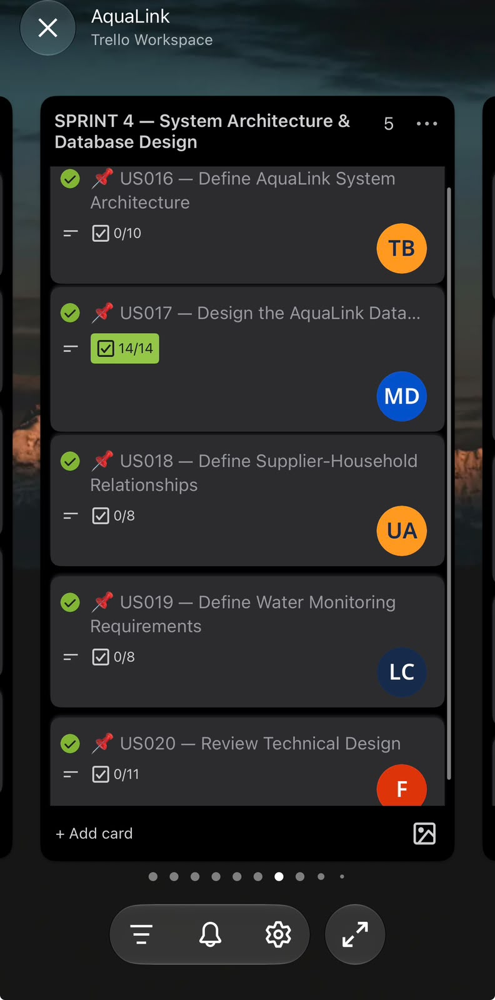
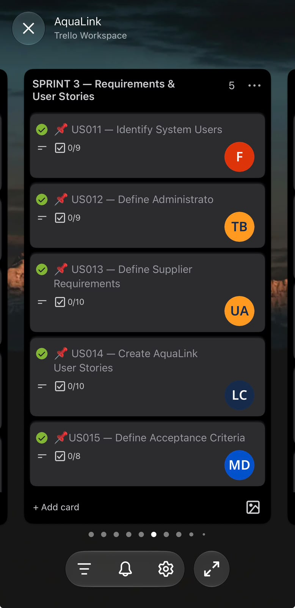

Agile Portfolio · Requirements & Development

# User Stories & Tasks

### Turning community needs into meaningful digital experiences.

AquaLink began with a social problem, but addressing that problem through software required more than identifying what was wrong.

We needed to understand who would use our solution, what those users needed to accomplish, and how their requirements could be translated into practical development tasks.

For me, this was one of the most important connections between Agile planning and frontend development.

A feature could sound useful in a meeting, but until it became an understandable screen, navigation flow or interaction, its value remained largely theoretical.

---

## 01. Understanding Our Users

AquaLink's application was organised around three principal user roles.

◈

### Administrator

Responsible for reviewing and managing operational information across the platform, including households, suppliers and subscription-related activities.

◉

### Supplier

Uses supplier-facing screens to review water infrastructure information, tanks, refill records and alerts.

⌂

### Household

Represents community members who need accessible information about their water-related services and subscriptions.

These roles helped us organise the application around different user responsibilities instead of designing every screen for the same type of user.

---

## 02. From Requirements to User Stories

During the requirements stage, we identified user needs and began translating them into tasks that could be organised through our Agile workflow.

Our Agile Logbook records requirements and user-story refinement during **27–31 July 2026**.

The examples below are portfolio summaries of the requirements and screens reflected in our project records. They are not presented as word-for-word quotations from Trello.

| User Role | User Story | Related Development Work |
|---|---|---|
| Administrator | As an administrator, I want an overview of platform operations so that I can monitor important information. | Admin dashboard |
| Administrator | As an administrator, I want to review household information so that I can understand the households recorded on the platform. | Household list and detail screens |
| Administrator | As an administrator, I want to review subscription plans so that I can understand available services and purchase information. | Plan management and purchase screens |
| Supplier | As a supplier, I want to view tank information so that I can monitor the water infrastructure associated with my work. | Tank overview and detail screens |
| Supplier | As a supplier, I want to review refill history so that I can understand previous refill activity. | Refill history screens |
| Supplier | As a supplier, I want to review alerts so that I can identify situations requiring attention. | Supplier and sensor alert screens |

The purpose of these stories was to connect system functionality to the needs of the people who would use it.

---

## 03. Breaking Stories into Development Tasks

A user story describes a need. A development task describes the work required to address that need.

For example, an administrator's need to review household information can be broken into several frontend tasks:

1. Design the household listing interface.
2. Determine which household information should be visible.
3. Create the household detail layout.
4. Implement navigation between the listing and detail screens.
5. Handle empty, loading and error states where applicable.
6. Test the screens for usability and responsiveness.

This is an illustrative task breakdown used to explain the development process, not a claim that these exact six items appeared as separate Trello cards.

Example · Story to Feature

### Administrator Household Management

**User need:** Review household records.

**Interface work:** Household listing and detail screens.

**Expected experience:** The administrator should be able to understand the information presented and move between the relevant screens without confusion.

**Development consideration:** Consistent layouts, readable information and clear navigation.

---

## 04. My Contribution to the Frontend

My contribution to AquaLink extended significantly into the frontend.

I worked on how the application looked and felt, as well as features that users would interact with.

This included attention to page layouts, visual consistency, navigation and the overall experience of using the application.

I wanted the interface to communicate professionalism, but I also wanted it to be understandable.

A system intended to support community services should not introduce unnecessary complexity for the people using it.

This shaped how I thought about frontend development: not merely as styling pages, but as translating requirements into experiences that users can navigate.

---

## 05. Evidence from Our Agile Planning

Our Trello board contains a **Sprint 1 — Requirements & User Stories** section, alongside subsequent sprint tasks covering implementation.

The following images are part of our original Trello screenshot collection.

### Requirements and Task Evidence

*Original Trello evidence from our Agile planning records.*

*Additional Trello screenshot showing project planning and task information.*

### Supporting Records

- [View the Original Trello Board](https://trello.com/invite/b/6a61c8f1356d8a59c782231c/ATTIf9d9fdf7ec47fcd3745825ca9a054a2898604B70/aqualink)
- [View the Product Backlog](product-backlog.html)
- [View the Agile Logbook](agile-logbook.html)
- [Explore the Evidence Gallery](evidence-gallery.html)

The screenshots will display after the original image files are uploaded to the evidence folder.

---

## 06. My Reflection: Understanding What Users Need

Working on user stories and tasks helped me understand the relationship between requirements and implementation.

At the beginning of a project, it is easy to focus on what the system should contain.

But during frontend development, I began to appreciate a different question:

> How will the person using this system actually experience the feature we are building?

An administrator does not simply need a page called "Households". They need information organised in a way that makes their responsibilities easier to perform.

A supplier does not simply need a page called "Tanks". They need an interface that communicates relevant information clearly.

This experience helped me see user stories as more than planning documents. They provide a connection between the user's purpose and the developer's decisions.

### The Leadership Challenge

As Project Lead, I also learned that breaking work into tasks does not automatically guarantee delivery.

There were periods when participation was inconsistent and deadlines were missed.

This could be frustrating, particularly when I was also responsible for substantial frontend development.

The experience taught me that tasks need clear ownership, expectations and follow-up.

I realised that coordinating development requires more than asking whether work has been completed. It also means understanding whether the assigned person knows what is expected and whether something is preventing progress.

### What I Would Improve

If I were approaching a similar project again, I would strengthen the relationship between user stories and development tasks by:

1. Giving each user story a unique identifier.
2. Linking every development task to its parent user story.
3. Defining testable acceptance criteria before implementation.
4. Making task ownership and deadlines explicit.
5. Reviewing progress regularly instead of waiting until deadlines are missed.
6. Recording whether each story has been implemented, tested and accepted.

These are improvements I would introduce in future projects, rather than claims that all of these practices were consistently followed during AquaLink.

---

## 07. What This Experience Taught Me

AquaLink taught me that good frontend development begins long before the interface is written.

It begins with understanding the user.

My responsibility was not simply to make AquaLink visually appealing. It was to help turn our requirements into an application that people could understand and interact with.

And as a leader, I learned that successful implementation depends on both technical work and the people responsible for delivering it.

**A user story gives a feature its purpose. The development process gives that purpose a practical form.**

---

[← Agile Team Charter](agile-team-charter.html)

[Next: Product Backlog →](product-backlog.html)

